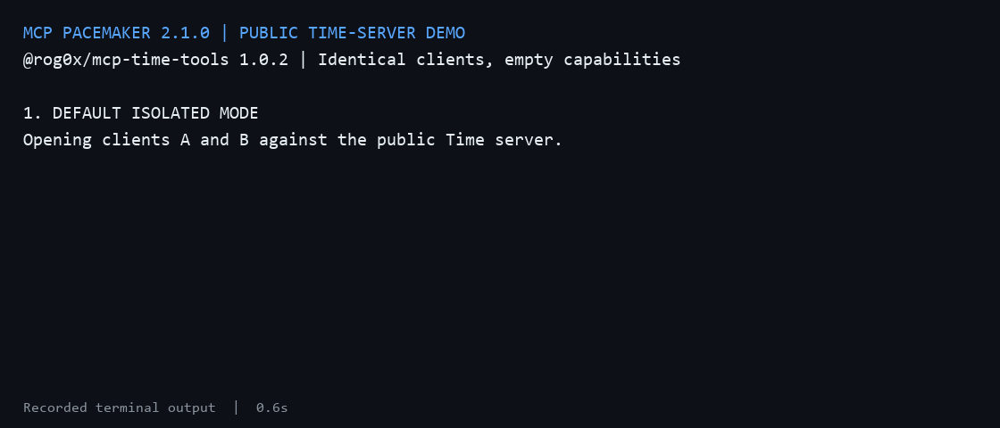

# mcp-pacemaker

**Keep your MCP servers running outside the editor or CLI.** One long-lived local bridge runs your MCP servers and every editor and agent CLI connects to it, so a CLI exiting no longer kills them.



```bash
npm install -g mcp-pacemaker   # Node 22 or 24, run as a normal user
mcp-pacemaker init             # imports your servers, asks before rewiring any host
```

[Install from npm](https://www.npmjs.com/package/mcp-pacemaker) ·
[Report a problem](https://github.com/girishkvs/mcp-pacemaker/issues) ·
[Release notes](https://github.com/girishkvs/mcp-pacemaker/releases) ·
[Demo and design write-up](https://girishkonda.com/projects/mcp-pacemaker/)

> This README describes **2.1.2**.
> See the [release changes](CHANGELOG.md).

## What it does

MCP hosts — editors (VS Code, Cursor, Claude Desktop) **and** CLIs (Claude Code, Copilot CLI,
Codex, Gemini) — run stdio MCP servers as child processes. When the host restarts, crashes, or
exits (every one-shot CLI run), **those servers die**.

- **Keeps servers running.** `mcp-pacemaker` runs your servers as children of a small,
  long-lived bridge and exposes each over the MCP HTTP+SSE / Streamable HTTP transport.
- **Shares one bridge.** Multiple hosts use one bridge, with an isolated child per session by
  default. Opt into pre-warming or reuse one initialized child for compatible stateless tools
  sessions with [shared mode](docs/configuration.md#shared-mode). Wire hosts to one bridge, or
  give each its own.
- **Survives reboots and token expiry.** A cross-platform supervisor + OS auto-start keep the
  bridge itself alive across reboots and sleep/wake, and a pluggable auth layer injects a fresh
  token per request for HTTP servers.
- **Reconnects returning clients.** After a restart, a returning client can reuse a recorded
  session ID to re-establish its handshake against a fresh server. This does not restore
  arbitrary tool state or preserve TCP connections. Clients that stop retrying after a dropped
  connection may still need a reload; socket handoff is separate planned work.
- **Shows what is running.** `status`, `top` and a web dashboard show whether each server is up
  and which clients use it. See [dashboards](docs/dashboards.md).

## Quick start

Install **mcp-pacemaker 2.1.2** from npm. Use a maintained **Node.js 22 or 24**
release; Windows also needs PowerShell 7 and Windows Script Host.
See [installation requirements](docs/install.md) before setup.

```bash
npm view mcp-pacemaker@2.1.2 version
npm install -g mcp-pacemaker@2.1.2
mcp-pacemaker --version
```

The version check prints `2.1.2` without running setup.

> **Run it as an ordinary user.** From 2.1.0 the bridge, supervisor and default upgrades
> refuse a privileged caller *at startup* — a non-administrator terminal on Windows and a
> **non-root** session on Linux/macOS, including the default `root` user in most containers.
> A refused start prints `User-runtime execution refused: …`. There is no override; run as a
> normal user instead. See the [user-runtime contract](docs/execution-context.md).

Before setup, have a readable JSON host configuration containing server definitions, or
prepare [`~/.mcp-pacemaker/servers.json`](docs/configuration.md#serversjson). Supported import sources are
`vscode`, `cursor`, `claude` (Claude Desktop), `copilot-cli` and `gemini`.
Codex and Claude Code are wiring destinations, not import sources.

Then run interactive setup:

```bash
mcp-pacemaker init
```

`init` detects supported hosts, imports **one source host** (or reuses `servers.json`),
asks for confirmation before wiring the selected hosts, registers OS auto-start and
starts the bridge. Reload or restart the selected hosts afterward.

**Setup changes local configuration and auto-start.** Importing can create or update
`servers.json` before the wiring confirmation. Existing JSON/TOML host files get a `.bak`
before replacement; native Claude Code registrations do not. Keep your own protected
configuration backup, especially before repeating setup.

`--from` chooses the import source; `--client` chooses wiring destinations. For example,
`mcp-pacemaker init --from vscode --client codex` imports VS Code's definitions and wires
Codex. Without `--from`, setup prefers the first detected JSON host; it does not merge
every detected host. Omit `--yes` to keep the confirmation prompt.

Check the running bridge:

```bash
mcp-pacemaker status     # status without entering first-run setup
mcp-pacemaker top        # live terminal dashboard
mcp-pacemaker doctor     # diagnose config, reachability, wiring
```

<details>
<summary>Prefer to drive it yourself? The same steps, one at a time</summary>

`plan`, `install` and `emit` accept any [supported host](#supported-hosts) as a wiring target.
`import --from` accepts the five JSON import sources listed above. Run import first unless
you already have `servers.json`; `plan` needs that file.

```bash
mcp-pacemaker import  --from <source>          # write servers.json from one JSON host config
mcp-pacemaker plan    --client <host>          # dry run: show what install would change
mcp-pacemaker install --client <host>          # wire one host (--port N gives it its own bridge)
mcp-pacemaker start                            # start the bridge
```

```bash
# e.g. import from Cursor, then wire three hosts to the same bridge
mcp-pacemaker import  --from cursor
mcp-pacemaker install --client cursor
mcp-pacemaker install --client claude-code
mcp-pacemaker install --client gemini
```

Run `install` once per host you want wired; repeat with `--port N` instead to give a host its
own bridge. `emit` prints the config entries without writing anything, if you'd rather paste
them in.

</details>

## How it compares

Checked against each project's latest release on October 16, 2026. Every cell is sourced in
[docs/comparison.md](docs/comparison.md). These projects overlap; `mcp-pacemaker` focuses on
keeping MCP servers running on a developer workstation.

| | [Supergateway](https://github.com/supercorp-ai/supergateway) | [mcp-proxy](https://github.com/sparfenyuk/mcp-proxy) | [MCP Hub](https://github.com/ravitemer/mcp-hub) | [ToolHive](https://github.com/stacklok/toolhive) | **mcp-pacemaker** |
|---|---|---|---|---|---|
| Serves stdio servers over Streamable HTTP | ✅ | ✅ | ❌ | ✅ | ✅ |
| Serves stdio servers over SSE (legacy) | ✅ | ✅ | ✅ | ✅ (deprecated) | ✅ |
| What you install | npm, binary or Docker | PyPI or Docker | npm or Nix | Go binary + Docker or Podman | npm; the bridge has **zero** dependencies |
| Restarts crashed processes automatically | new child per connection | ❌ | manual restart (API) | ✅ | ✅ bridge and warm pools |
| Starts at OS logon | ❌ | ❌ | ❌ | desktop app only | ✅ Windows, macOS, Linux |
| Starts again after unlock or wake | ❌ | ❌ | ❌ | ❌ | ✅ Windows |
| Auth header from your own command, auto-refreshed | ❌ | ❌ | at connect only | ❌ | ✅ |
| Sessions survive a bridge restart without re-initializing | ❌ | ❌ | ❌ | Kubernetes with Redis only | ✅ |
| Timed restart to refresh an interactive login | ❌ | ❌ | ❌ | ❌ | ✅ |
| Reuses existing client MCP config files | ✅ | stdio entries only | ✅ | ❌ | ✅ |
| Wires editors and CLIs for you | ❌ | ❌ | ❌ | ✅ | ✅ |
| Web dashboard | ❌ | ❌ | ❌ | desktop app instead | ✅ |
| Terminal dashboard | ❌ | ❌ | ❌ | ✅ (experimental) | ✅ |
| HTTP control API | health checks only | `/status` only | ✅ | ✅ | ✅ |

A surviving session re-establishes the client's handshake against a fresh server; it does not
restore arbitrary tool state. A transport bridge is not a sandbox for untrusted tools.

## Everyday commands

| Command | What it does |
|---|---|
| `init [--from source] [--client a,b] [--yes]` | Interactive setup: import one source, wire selected hosts, auto-start, launch |
| `status` | Bridges, wired hosts, servers, and any server currently failing |
| `top` / `dashboard` | Live terminal UI / web dashboard |
| `doctor` | Diagnose config, bridge reachability, host wiring |
| `uninstall` | Stop managed bridges, remove auto-start, restore available host-file `.bak` copies; native entries are not restored |

The [command reference](docs/operations.md#command-reference) lists every command, including
`reload`, `logs`, `prewarm`, `upgrade` and `--instance`.

## Which process-sharing mode?

Sharing a bridge does not automatically share a server process.

| Mode | Process behavior | Use when |
|---|---|---|
| `isolated` (default) | One child per session | The server needs per-client workspace, account or conversation state |
| `pool` (opt-in) | Pre-started, uninitialized children; each is assigned exclusively to one session | Startup is slow but sessions must remain separate |
| `shared` (opt-in) | One initialized child for compatible sessions | Tools are stateless, inputs are explicit and the credential context is common |

Shared clients must send identical initialization parameters, including `clientInfo`, and
empty client capabilities. It is not automatic cross-editor sharing. See
[shared-mode limits](docs/configuration.md#shared-mode) before enabling it.

## Supported hosts

Editors and CLIs are auto-detected and wired to the bridge. Most hosts get Streamable HTTP
(`/<name>/mcp`); Cursor and Claude Desktop are wired over SSE (`/<name>/sse`) until Streamable
HTTP is verified there. The bridge centralizes auth, so hosts talk to it unauthenticated over
loopback.

| Host | Type | Config | Wiring | Transport |
|---|---|---|---|---|
| VS Code | editor | `Code/User/mcp.json` | direct edit | Streamable HTTP |
| Cursor | editor | `~/.cursor/mcp.json` | direct edit | SSE |
| Claude Desktop | editor | `claude_desktop_config.json` | direct edit | SSE |
| Claude Code | CLI | `~/.claude.json` | native `claude mcp add` | Streamable HTTP |
| Copilot CLI | CLI | `~/.copilot/mcp-config.json` | direct edit | Streamable HTTP |
| Codex CLI | CLI | `~/.codex/config.toml` | TOML (comment-preserving) | Streamable HTTP |
| Gemini CLI | CLI | `~/.gemini/settings.json` | direct edit | Streamable HTTP |

**Topologies:** wire every host to one shared bridge (default), or give each host its own bridge
(`install --client X --port N`) — or any mix. `status`/`doctor` report all bridges + wired hosts.

## Upgrades

> Package installation alone does not upgrade a running backend. Use explicit `upgrade --to`
> for managed replacement. Bare `upgrade` retains the older host-repair behavior.

Managed upgrades need **2.1.0 or newer** and must run as an ordinary user. Start with
`mcp-pacemaker upgrade --to <exact-version> --plan`, which changes nothing. `--sxs` keeps the
old instance and starts an isolated new one. Do not overwrite a package directory while its
supervisor or bridge is running. An upgrade may end open sessions and calls in progress;
clients reconnect, and no call is retried. It never changes `servers.json` or your client setup.

The [one-time Windows 1.3 restart migration](docs/upgrades.md#one-time-windows-13-restart-migration)
restarts **Pacemaker, not Windows**. It stops the 1.3 bridge and the processes it started, so
open sessions end. Confirm it at the prompt or with `--yes`. Run it from a separate durable
package; do not overwrite the running 1.3 package first. If 1.3 was set up from an
administrator terminal, run `mcp-pacemaker upgrade --fix-legacy-access` once from an
administrator terminal first; see [that section](docs/upgrades.md#13-installs-set-up-from-an-administrator-terminal).

See [upgrades and rollback](docs/upgrades.md) for recovery, rollback and side-by-side instances.

## Uninstall

`install` backs up an existing JSON/TOML host file to `.bak`; repeating it replaces that backup.
`uninstall` restores available host-file backups, leaves files without backups as-is, and
keeps `servers.json`. Native Claude Code registrations are not backed up or automatically
restored; record their original definitions separately and restore them through Claude Code.

```bash
mcp-pacemaker uninstall      # use the CLI from the matching installed version
```

This stops managed bridges, removes auto-start entries and restores available host-file
backups. It leaves files without backups and native Claude Code registrations unchanged.
It is not scoped to one port; review [replacement and rollback](docs/upgrades.md#replacing-or-rolling-back-a-running-installation)
first if another instance must remain running. Do not fetch a different CLI with `npx`
to remove an existing installation.

After the installed service has been removed successfully, remove the global npm package:

```bash
npm uninstall -g mcp-pacemaker
```

## Security

- The bridge binds **`127.0.0.1` only** (local loopback) — not reachable off-box.
- Tokens are **minted from your own already-authenticated CLI** and cached in memory; **never written to disk**.
- The **bridge** (the process that runs 24/7) has **zero third-party dependencies**; the setup CLI uses `commander` / `@clack/prompts` / `picocolors` / `smol-toml`, and the TUI adds `ink` / `react`.

See [SECURITY.md](SECURITY.md) for the threat model and how to report a vulnerability. The
[HTTP API](docs/http-api.md) page explains how administrative requests are guarded.

## Documentation

- [Install details](docs/install.md) — Node and Windows requirements, the ordinary-user rule and npm channels
- [Configuration](docs/configuration.md) — `servers.json`, auth, live edits, resource controls and shared mode
- [Commands and operations](docs/operations.md) — every command, start and stop, durable logs and server health
- [Dashboards](docs/dashboards.md) — the web dashboard, pre-warming controls, the health tab and `top`
- [HTTP API](docs/http-api.md) — endpoints, pooling batches and the admin nonce
- [Upgrades and rollback](docs/upgrades.md) — managed upgrades, `--sxs`, recovery and the Windows 1.3 migration
- [Version compatibility](docs/compatibility.md) — 1.3.x and 2.x pairs, and upgrading from 1.3.0
- [How it compares](docs/comparison.md) — sourced comparison with Supergateway, mcp-proxy, MCP Hub and ToolHive
- [User-runtime contract](docs/execution-context.md) — what the ordinary-user check verifies
- [Shared sessions](docs/shared-sessions.md) — the full shared-mode contract
- [Account upgrades](docs/account-upgrades.md) — explicit original-account upgrades on Windows
- [Roadmap](docs/roadmap.md) — planned work, including socket handoff

## Project

- [CHANGELOG.md](CHANGELOG.md) — release notes
- [CONTRIBUTING.md](CONTRIBUTING.md) — development setup and how regression tests are expected to be proven
- [SECURITY.md](SECURITY.md) — threat model and how to report a vulnerability
- Publishing and qualification: [npm publishing](docs/npm-publishing.md),
  [local publication gate](docs/local-publication-gate.md) and
  [cross-host live validation](docs/cross-host-live-validation.md)

## License

MIT © Girish Konda
