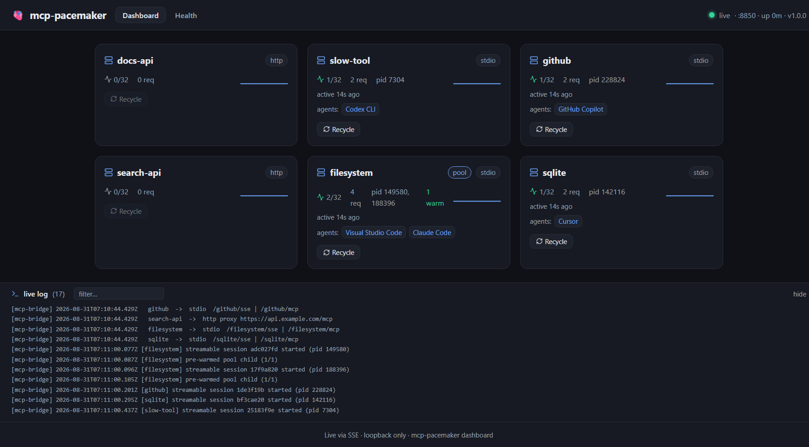
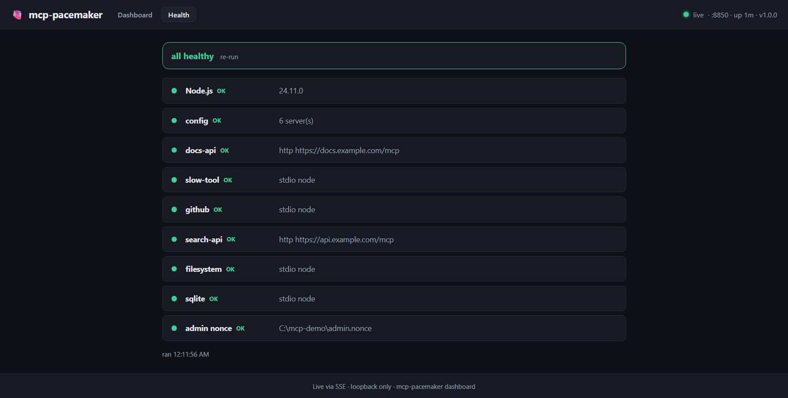

# Dashboards

Two views of the same live state. Neither is required — the bridge runs headless — but both are
useful for answering "is this server actually up, and who is using it?"

## Web dashboard

`mcp-pacemaker dashboard`, or open `http://127.0.0.1:<port>/ui`. It streams over SSE, so it
updates on its own without polling or a refresh.



Per server it shows the transport (`stdio` / `http`), the sharing policy (`pool` when pre-warming),
live sessions against the cap, request count, the actual OS pids, the warm-pool count, how long
ago it was last used, and **which clients are connected** — above, one server is shared by
VS Code and Claude Code while others are held by Copilot, Cursor and Codex. `Recycle` restarts
that server's processes; it is disabled for servers with no session to restart. The live log at
the bottom is the bridge's own log, filterable.

## Pre-warming controls

The **Pre-Warming** tab puts every stdio candidate, current pool and shared server in one table.
It shows cold-start p50/p95, observed peak sessions, process starts, warm/target counts,
shared-child state and pending work, and an action.
HTTP proxies are excluded because the bridge does not launch their processes.

Choose **Enable pre-warming (N)** on a slow-server card or in the table. The button shows
the exact warm count and the extra resident-process cost before you click. Nothing enables
it automatically. **Disable pre-warming** removes idle warm children without killing active
sessions after the change is applied.

Changes are batched in a **complete pending copy** of `servers.json`. Every accepted change
resets a five-second countdown. When editing stops, reload validates the pending copy, retains
the original as `servers.previous.json`, flips the pending file into place, and activates the
new settings. The dashboard shows **Pending** or **Applying** until that succeeds; active
mode and warm counts are not changed early. **Reload now** flushes the same batch immediately.

**Cancel batch** discards a pending batch without changing active settings. **Undo batch**
stages the full previous configuration for another five-second batch, only if no intervening
active-file edit has occurred. These actions affect the entire batch; the dashboard names all
affected servers. An unrelated pending batch must be cancelled or applied before Undo.

The same controls are available without a browser:

```sh
mcp-pacemaker prewarm --port 8791
mcp-pacemaker prewarm --port 8791 --enable filesystem --count 2
mcp-pacemaker prewarm --port 8791 --disable filesystem
# Changes are queued; the printed command cancels a pending batch or undoes it after application.
```

Use `--config <path>` when the bridge's config and admin nonce are outside the default
directory. `--json` returns the measured snapshot. The CLI and UI use the same server
eligibility and recommendation data; a missing latency sample is not reported as a zero-cost
startup. The CLI returns after staging, so consecutive commands can join the same batch.
`prewarm` shows pending settings separately from active values. Config remains strict JSON,
not JSONC; the pending copy preserves unrelated JSON and requires a matching active revision.
Conflicts are reported rather than overwriting someone else's edit.

On Windows, saves run with the normal bridge account and use **directory-inherited auditing**.
The dashboard gives a non-blocking notice: custom per-file audit rules may not carry forward
to the new active copy. The retained original keeps its original metadata. No audit-read
privilege, UAC prompt, or permanently elevated bridge is required.

This does not permit broader access to configuration data. Candidates must have appropriate
access restrictions before any configuration bytes are written, and supported integrity
protections must be retained. Actual source write denial or unsupported protection remains
an error. Configuration operations run in a serialized worker so file inspection does not
block MCP traffic.

Windows security inspection uses the bundled, own-source .NET Framework helper rather than
starting PowerShell or compiling code on each write. Automatic edits require .NET Framework
4.6.2 or later; modern Windows includes it. The helper's source, build instructions and
integrity metadata are [included in the package](../tools/windows-security-helper/README.md).
Windows ARM64 execution is not yet validated.

Staging requests and file commits each have a bounded execution budget; the acknowledged
five-second batching delay does not keep the original HTTP request open. A commit already in
progress can finish after its deadline. The result distinguishes a pre-commit failure from
a committed or unknown outcome; it never automatically retries or claims a timed-out write
was rolled back.

The two file moves are not an atomic exchange. Reload coordinates them with validated recovery
state and non-replacing destination placement. Existing MCP traffic continues using the
previous in-memory configuration during the flip; an external reader can briefly find the
active path absent. Recovery must not overwrite a file created by an external editor.
Reread the settings after an uncertain result.

If you are upgrading from 1.3.0, see [upgrading from 1.3.0](compatibility.md#upgrading-from-130)
for the configuration-save change and the reload that open dashboard tabs need.

## Health

The `Health` tab runs the same checks as `mcp-pacemaker doctor`, so you can see them without a
terminal.



It checks the Node version, that the config parses, every server definition (including a stdio
server whose relative path will not resolve from the directory it would run in — a failure that
is otherwise silent until a client first calls it, and a server named after one of the bridge's
own routes, which is unreachable), any server currently failing, and that the admin nonce file
exists.

## Terminal dashboard

`mcp-pacemaker top` is the same data as an Ink TUI, for when a browser is inconvenient:

```
🫀 mcp-pacemaker top                                     ● :8850 · up 176s · v1.1.0
SERVER            TYPE   HEALTH  SESS  WARM  REQ    PID       TOKEN   ERROR / CLIENTS
filesystem        stdio  ok      2     1/1   8      186276,12 -       ⇄ Visual Studio Code,Claude Code
github            stdio  ok      1     -     2      146436    -       ⇄ GitHub Copilot
sqlite            stdio  ok      1     -     2      102108    -       ⇄ Cursor
slow-tool         stdio  ok      1     -     2      103776    -       ⇄ Codex CLI
search-api        http   FAIL×3  0     -     4      -         42m     upstream rejected the crede
docs-api          http   ?       0     -     0      -         -
↑↓ select · r recycle · q quit
```

`HEALTH` is `ok` when the last request to that server succeeded, `FAIL×n` after n consecutive
failures, and `?` when nothing has called it yet — deliberately not `ok`, since no evidence is not
the same as working. `WARM` shows `warm/minWarm` for pooled servers and `-` for the rest, `TOKEN`
the time left on a cached credential, and the last column either the connected clients or the last
error. `↑↓` selects a row and `r` recycles it.
